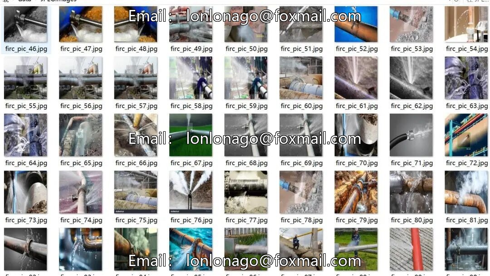
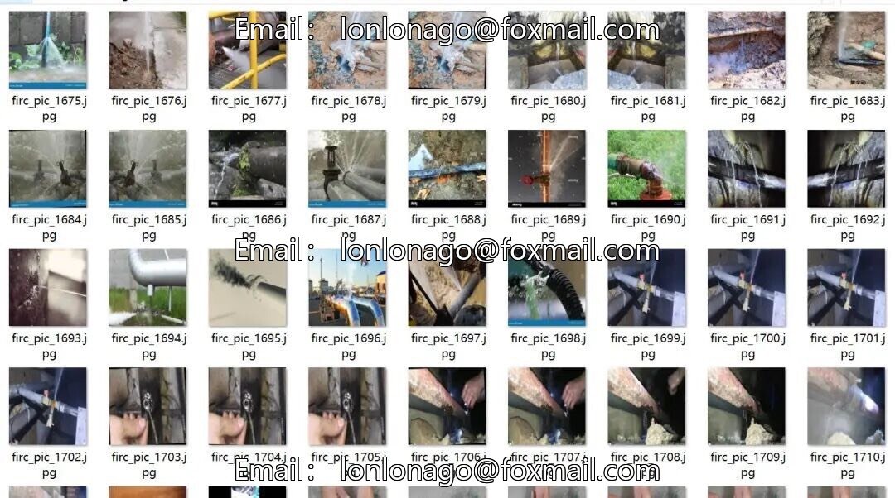
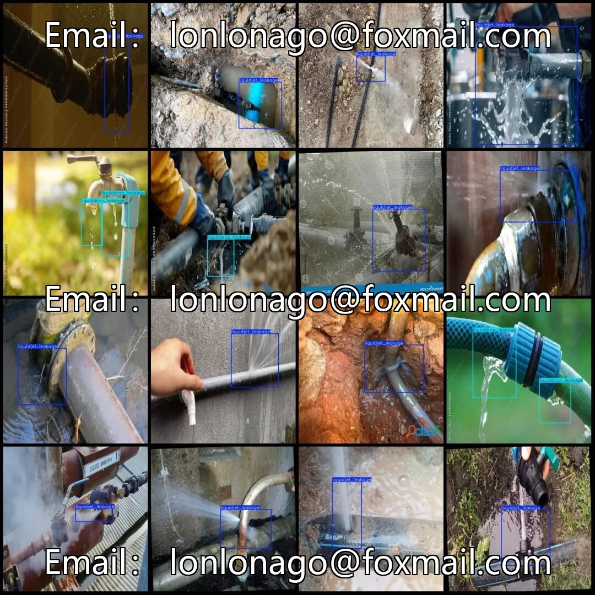
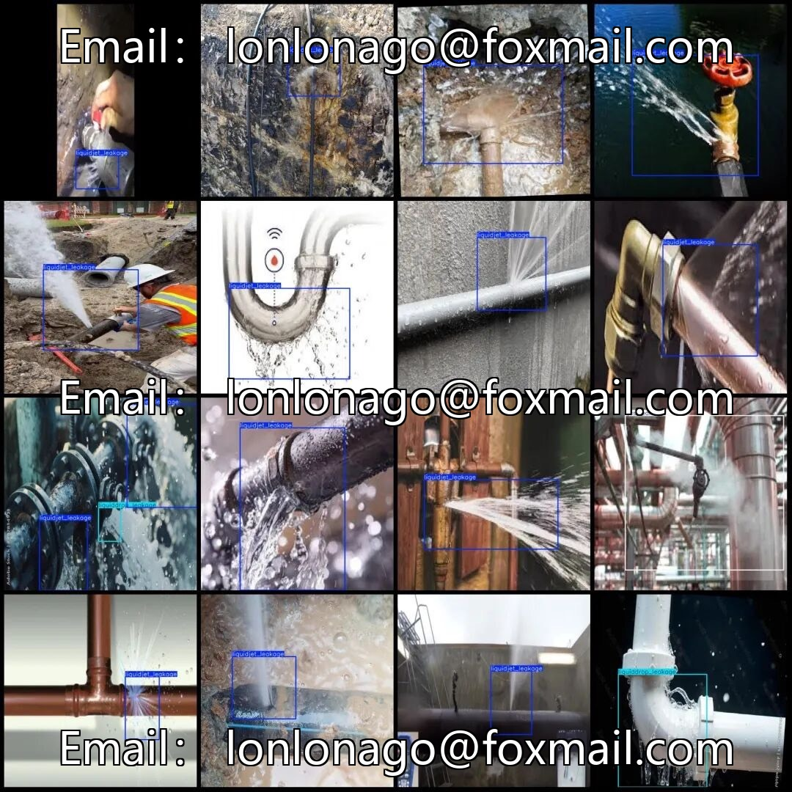

# Pipeline leak detection dataset, including three major categories: gas leaks, droplet leaks, and liquid spray leaks.

## Body

Pipeline Leakage Detection Dataset, comprising three categories: gas leakage, droplet leakage, and liquid spray leakage, totaling 2099 images. Each image is associated with a VOC format xml annotation file and a yolo format txt annotation file, in Pascal VOC+YOLO format without the segmentation path txt file. The resolution of all images is 640x640. The annotation tool used is labelImg, and the annotation rules are to draw rectangle boxes for classifying the category.

The dataset has not been split into training, validation, and test sets, so it needs to be manually divided. The annotation categories are as follows: gas_leakage (gas leakage), liquiddrop_leakage (liquid droplet leakage), liquidjet_leakage (liquid jet leakage). The number of bounding boxes for each category is respectively: gas_leakage 215, liquiddrop_leakage 203, liquidjet_leakage 1887, total bounding boxes 2305, the number of images matches the number of annotations.

The dataset only contains jpg images, VOC format xml, and yolo format txt. It does not involve other content. This dataset does not guarantee the accuracy of the training model or weight files.

Virtual materials, once sold, are non-refundable.
Interested friends, click "I want" to proceed.

## Images

## Payment

Here is a pay link on Stripe ( https://buy.stripe.com/3cs8yP7sY87d0vu9AB ). Please contact me lonlonago@foxmail.com after funding $89, and I will send you a complete data files , thank you!

